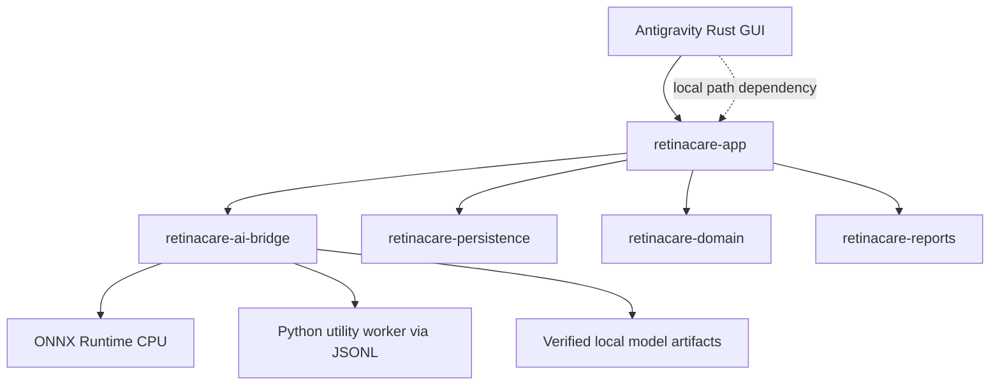

<!-- migrated 2026-10-28 from /home/claude/Desktop/Dird/memory/architecture-overview.md (sha256 4b5792ae5f4a); verify current state in [[active-phase]] -->
# Architecture overview

Dird Rust workspace contains six crates: retinacare-domain,
retinacare-persistence, retinacare-reports, retinacare-ai-bridge,
retinacare-app and retinacare-ui. AI bridge owns manifest verification,
OpenCV preprocessing, ONNX sessions and Python worker IPC; app owns async
service orchestration and resource paths. Persistence owns SQLCipher.

The separate GUI in Hackthon dezine/rust depends by local relative path on
Dird AI bridge and app crates. It does not share one Cargo workspace. Its live
adapter currently submits Stage I only. Exact paths and seams:
[[Archive/dird-memory-pre-consolidation/source-map]], [[Archive/dird-memory-pre-consolidation/agent-ownership]], [[Archive/dird-memory-pre-consolidation/data-contracts]].

Legacy DIRD+ is separate web/Tauri implementation under src/ and src-tauri/;
it remains reference, not the native architecture.
