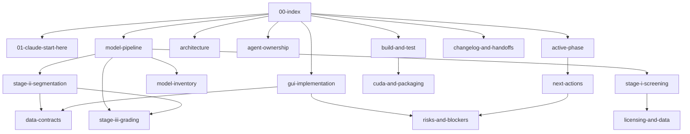

<!-- migrated 2026-10-28 from /home/claude/Desktop/Dird/memory/graph-overview.md (sha256 7684ed341026); verify current state in [[active-phase]] -->
# Knowledge graph overview

Start at [[Archive/dird-memory-pre-consolidation/00-index]]. Read [[Archive/dird-memory-pre-consolidation/01-claude-start-here]] and [[Archive/dird-memory-pre-consolidation/active-phase]] before
following one workstream. Obsidian Graph View uses the real wikilinks below;
this Mermaid diagram is a readable supplement.

Validation on 2026-10-28: 32 notes, 135 resolved directed wikilink edges,
0 broken links, 0 orphan notes, and 73 existing source references. External
repository docs use relative Markdown links and do not become graph nodes.
Mermaid fences and YAML frontmatter parse; Obsidian rendering was not tested.
See [[Archive/dird-memory-pre-consolidation/README]] for opening instructions and vault-selection limits.
