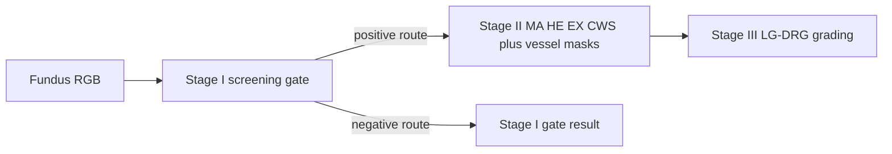

<!-- migrated 2026-10-28 from /home/claude/Desktop/Dird/GUI/Hackthon dezine/memory/Models/model-pipeline.md (sha256 9604cc01030c); verify current state in [[active-phase]] -->
# Model pipeline

HierarchiRetina has three AI stages: (I) binary screening gate, (II) four
lesion masks plus vessel mask, (III) LG-DRG five-class grading using RGB and
the five masks. These are model stages; GUI, attribution, chat and report
export are not extra AI stages. No Stage IV is documented by the pinned model
pipeline.

Current implementation and assets: [[Archive/gui-vault-backend-mirrors/Models/stage-i-screening]],
[[Archive/gui-vault-backend-mirrors/Models/stage-ii-segmentation]], [[Archive/gui-vault-backend-mirrors/Models/stage-iii-grading]], [[Archive/gui-vault-backend-mirrors/Models/model-inventory]].
Threshold routes are research outputs, not diagnoses. See [[Archive/gui-vault-backend-mirrors/Models/licensing-and-data]].
